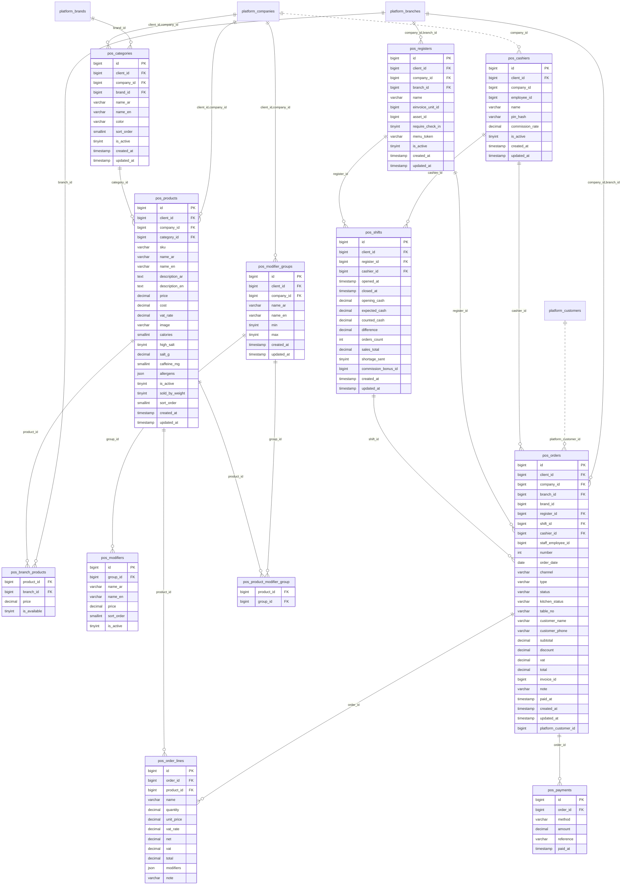
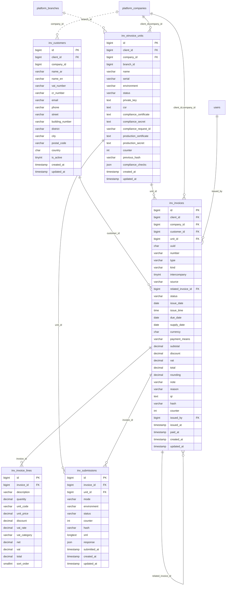
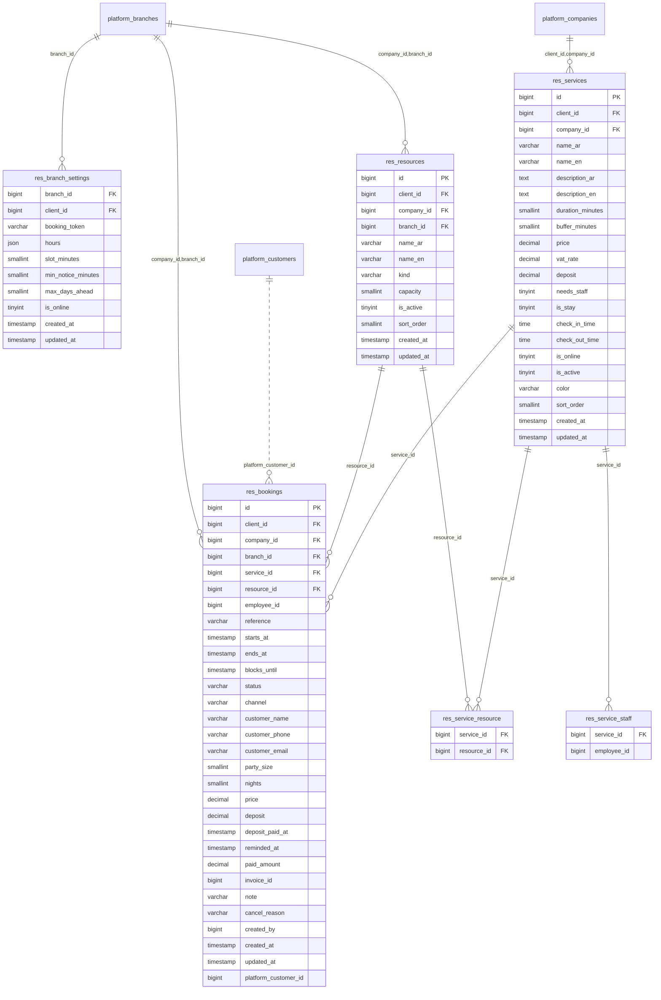
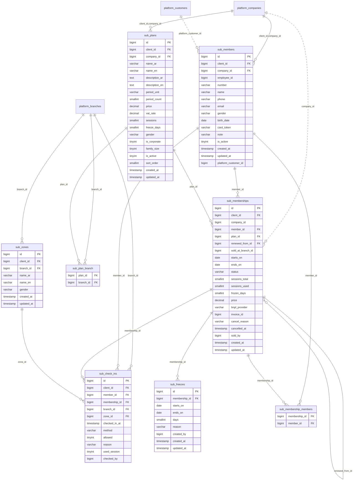
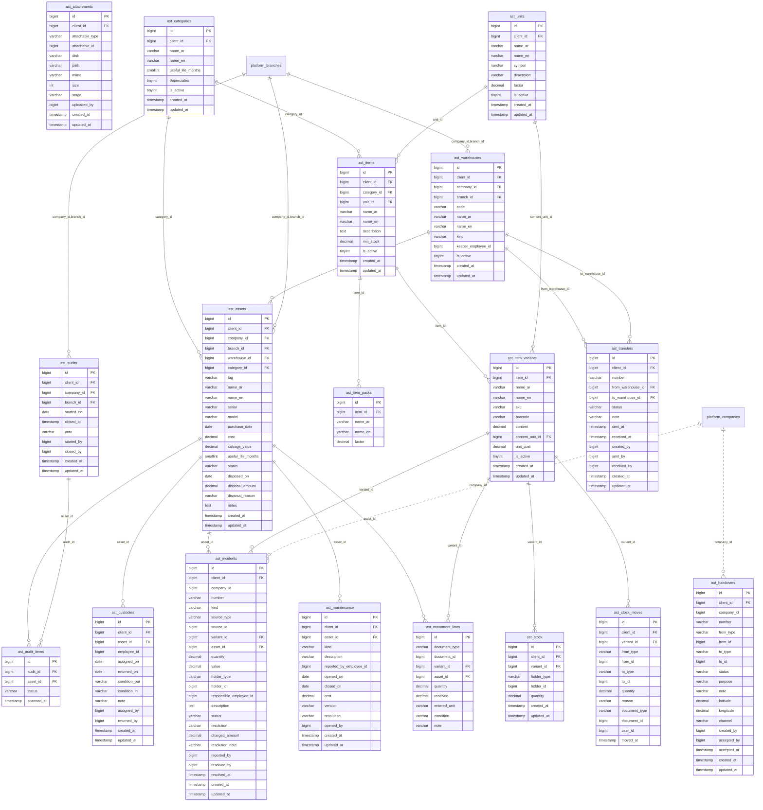
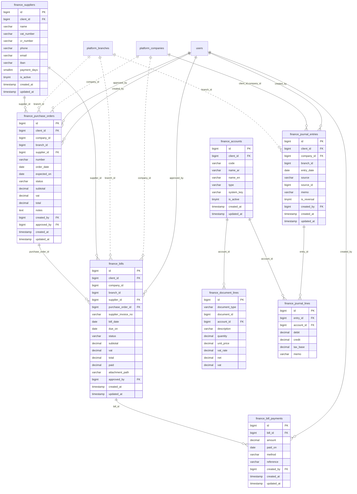

# Baydaq ER diagram

> Generated from the database schema by `php artisan docs:er`. Do not edit by hand: change a
> migration, run `php artisan migrate` and `php artisan docs:er`. The test
> `tests/Feature/Docs/ErDiagramTest.php` fails while this file is out of date.
>
> Solid lines are database foreign keys. Dotted lines are links by convention (ids that point
> across modules, which the modular design keeps without a foreign key). `client_id` (the tenant)
> is on almost every table and is not drawn.

## Tables per module

- Platform (kernel: tenants, structure, access, packages, customers): 23 tables
- HR: 48 tables
- Point of sale: 12 tables
- Invoicing (ZATCA): 5 tables
- Reservations: 6 tables
- Subscriptions (memberships): 8 tables
- Assets and inventory: 18 tables
- Finance (ledger, purchasing): 8 tables
- Core app (users, clients, portal, permissions): 25 tables

## Platform (kernel: tenants, structure, access, packages, customers)

```mermaid
erDiagram
    platform_access_assignments {
        bigint id PK
        bigint client_id FK
        bigint user_id FK
        bigint access_role_id FK
        varchar level
        bigint organization_id FK
        bigint company_id FK
        bigint branch_id FK
        varchar scope_key
        timestamp created_at
        timestamp updated_at
    }
    platform_access_role_permissions {
        bigint id PK
        bigint access_role_id FK
        varchar permission
    }
    platform_access_roles {
        bigint id PK
        bigint client_id FK
        varchar key
        varchar name_ar
        varchar name_en
        tinyint is_locked
        timestamp created_at
        timestamp updated_at
    }
    platform_addons {
        bigint id PK
        varchar code
        varchar name_ar
        varchar name_en
        decimal price_monthly
        json modules
        json features
        json mobile
        json limits
        tinyint is_active
        timestamp created_at
        timestamp updated_at
    }
    platform_audit_events {
        bigint id PK
        bigint client_id FK
        bigint actor_id FK
        varchar auditable_type
        bigint auditable_id
        varchar event
        json changes
        varchar ip
        timestamp created_at
    }
    platform_branches {
        bigint id PK
        bigint client_id FK
        bigint company_id FK
        varchar code
        varchar name_ar
        varchar name_en
        varchar city_ar
        varchar city_en
        tinyint is_head_office
        bigint head_office_company_id
        varchar status
        timestamp created_at
        timestamp updated_at
        char join_token
    }
    platform_brand_branch {
        bigint brand_id FK
        bigint branch_id FK
    }
    platform_brands {
        bigint id PK
        bigint client_id FK
        bigint company_id FK
        varchar slug
        varchar name_ar
        varchar name_en
        varchar logo
        varchar color
        tinyint is_active
        timestamp created_at
        timestamp updated_at
    }
    platform_client_plans {
        bigint id PK
        bigint client_id FK
        bigint package_id FK
        json addons
        json overrides
        varchar status
        varchar billing_cycle
        date starts_on
        date ends_on
        timestamp created_at
        timestamp updated_at
    }
    platform_companies {
        bigint id PK
        bigint client_id FK
        bigint organization_id FK
        varchar slug
        varchar name_ar
        varchar name_en
        varchar cr_number
        varchar vat_number
        varchar unified_number
        varchar gosi_number
        varchar qiwa_id
        varchar street
        varchar building_number
        varchar district
        varchar city
        varchar postal_code
        varchar timezone
        decimal loyalty_percent
        varchar client_scope
        varchar status
        timestamp created_at
        timestamp updated_at
    }
    platform_customer_registrations {
        bigint id PK
        bigint client_id FK
        bigint customer_id FK
        varchar scope_type
        bigint scope_id
        bigint branch_id
        varchar source
        bigint registered_by FK
        timestamp marketing_consent_at
        timestamp created_at
        timestamp updated_at
    }
    platform_customers {
        bigint id PK
        bigint client_id FK
        varchar name
        varchar phone
        varchar email
        date birth_date
        varchar gender
        decimal wallet_balance
        text notes
        timestamp created_at
        timestamp updated_at
        timestamp erased_at
    }
    platform_messages {
        bigint id PK
        bigint client_id FK
        varchar channel
        varchar to
        varchar template
        json params
        text body
        varchar locale
        varchar context
        varchar status
        varchar provider_id
        varchar error
        timestamp created_at
        timestamp updated_at
    }
    platform_organizations {
        bigint id PK
        bigint client_id FK
        varchar slug
        varchar name_ar
        varchar name_en
        varchar status
        timestamp created_at
        timestamp updated_at
    }
    platform_packages {
        bigint id PK
        varchar code
        varchar name_ar
        varchar name_en
        text description_ar
        text description_en
        decimal price_monthly
        decimal price_yearly
        smallint trial_days
        json modules
        json features
        json mobile
        json limits
        tinyint is_public
        tinyint is_active
        smallint sort_order
        timestamp created_at
        timestamp updated_at
    }
    platform_payments {
        bigint id PK
        bigint client_id FK
        varchar token
        varchar reference
        decimal amount
        char currency
        varchar description
        varchar provider
        varchar provider_id
        varchar checkout_url
        varchar status
        varchar return_url
        timestamp paid_at
        timestamp created_at
        timestamp updated_at
    }
    platform_privacy_requests {
        bigint id PK
        bigint client_id FK
        varchar kind
        varchar subject
        bigint customer_id
        varchar name
        varchar contact
        date received_on
        date due_on
        varchar status
        text details
        text outcome
        bigint handled_by FK
        timestamp closed_at
        timestamp created_at
        timestamp updated_at
    }
    platform_scope_shortcuts {
        bigint id PK
        bigint client_id FK
        bigint user_id FK
        varchar segment
        varchar branches
        varchar name
        tinyint pinned
        timestamp last_used_at
        timestamp created_at
        timestamp updated_at
    }
    platform_subscriptions {
        bigint id PK
        bigint client_id FK
        varchar module
        varchar status
        varchar billing_unit
        int quantity
        decimal unit_price
        date starts_on
        date ends_on
        text notes
        timestamp created_at
        timestamp updated_at
    }
    platform_themes {
        bigint id PK
        bigint client_id FK
        varchar app_name
        varchar logo_path
        char primary_color
        char accent_color
        varchar radius
        varchar mode
        timestamp created_at
        timestamp updated_at
    }
    platform_wallet_entries {
        bigint id PK
        bigint client_id FK
        bigint customer_id FK
        bigint company_id
        decimal amount
        decimal balance_after
        varchar kind
        varchar source
        varchar reference
        varchar note
        bigint user_id FK
        timestamp created_at
    }
    platform_work_location_branch {
        bigint work_location_id FK
        bigint branch_id FK
    }
    platform_work_locations {
        bigint id PK
        bigint client_id FK
        varchar name_ar
        varchar name_en
        decimal latitude
        decimal longitude
        smallint radius_m
        json wifi_bssids
        tinyint is_active
        timestamp created_at
        timestamp updated_at
    }
    users { }
    platform_access_roles ||--o{ platform_access_assignments : "access_role_id"
    platform_access_roles ||--o{ platform_access_role_permissions : "access_role_id"
    platform_branches ||--o{ platform_access_assignments : "branch_id"
    platform_branches ||--o{ platform_brand_branch : "branch_id"
    platform_branches ||--o{ platform_work_location_branch : "branch_id"
    platform_branches ||..o{ platform_customer_registrations : "branch_id"
    platform_brands ||--o{ platform_brand_branch : "brand_id"
    platform_companies ||--o{ platform_access_assignments : "company_id"
    platform_companies ||--o{ platform_branches : "client_id,company_id"
    platform_companies ||--o{ platform_brands : "client_id,company_id"
    platform_companies ||..o{ platform_wallet_entries : "company_id"
    platform_customers ||--o{ platform_customer_registrations : "customer_id"
    platform_customers ||--o{ platform_wallet_entries : "customer_id"
    platform_organizations ||--o{ platform_access_assignments : "organization_id"
    platform_organizations ||--o{ platform_companies : "client_id,organization_id"
    platform_packages ||--o{ platform_client_plans : "package_id"
    platform_work_locations ||--o{ platform_work_location_branch : "work_location_id"
    users ||--o{ platform_access_assignments : "user_id"
    users ||--o{ platform_audit_events : "actor_id"
    users ||--o{ platform_customer_registrations : "registered_by"
    users ||--o{ platform_privacy_requests : "handled_by"
    users ||--o{ platform_scope_shortcuts : "user_id"
    users ||--o{ platform_wallet_entries : "user_id"
```



## HR

```mermaid
erDiagram
    hr_advance_installments {
        bigint id PK
        bigint advance_id FK
        date due_month
        decimal amount
        decimal paid
        varchar status
        bigint payroll_line_id
    }
    hr_advance_repayments {
        bigint id PK
        bigint advance_id FK
        bigint installment_id FK
        decimal amount
        varchar method
        date paid_on
        varchar reference
        bigint recorded_by FK
        timestamp created_at
        timestamp updated_at
    }
    hr_advances {
        bigint id PK
        bigint client_id FK
        bigint employee_id FK
        decimal amount
        smallint installments
        date first_installment_month
        varchar status
        varchar disbursement
        date disbursed_on
        varchar reason
        bigint requested_by FK
        bigint approved_by FK
        timestamp created_at
        timestamp updated_at
    }
    hr_allowance_types {
        bigint id PK
        bigint client_id FK
        varchar name_ar
        varchar name_en
        varchar calculation
        decimal default_value
        tinyint counts_for_gosi
        tinyint is_active
        smallint sort_order
        timestamp created_at
        timestamp updated_at
    }
    hr_attendance_devices {
        bigint id PK
        bigint client_id FK
        bigint employee_id FK
        varchar device_id
        varchar platform
        varchar model
        timestamp bound_at
        timestamp created_at
        timestamp updated_at
    }
    hr_attendance_punches {
        bigint id PK
        bigint client_id FK
        bigint employee_id FK
        varchar type
        timestamp punched_at
        date work_date
        decimal latitude
        decimal longitude
        smallint accuracy_m
        tinyint mocked
        bigint work_location_id FK
        bigint branch_id FK
        bigint home_branch_id
        varchar flag
        varchar resolution
        varchar resolution_note
        bigint resolved_by FK
        timestamp resolved_at
        varchar source
        varchar device_id
        varchar selfie_path
        timestamp created_at
        timestamp updated_at
        tinyint is_remote
    }
    hr_bonus_types {
        bigint id PK
        bigint client_id FK
        varchar name_ar
        varchar name_en
        tinyint is_active
        smallint sort_order
        timestamp created_at
        timestamp updated_at
    }
    hr_bonuses {
        bigint id PK
        bigint client_id FK
        bigint employee_id FK
        bigint bonus_type_id FK
        decimal amount
        varchar status
        date pay_month
        varchar reason
        bigint payroll_line_id
        bigint requested_by FK
        bigint approved_by FK
        timestamp created_at
        timestamp updated_at
    }
    hr_breaks {
        bigint id PK
        bigint client_id FK
        bigint company_id
        bigint branch_id
        bigint employee_id FK
        varchar kind
        varchar status
        smallint minutes
        date work_date
        timestamp requested_at
        timestamp starts_at
        timestamp ends_at
        bigint decided_by FK
        varchar note
        timestamp created_at
        timestamp updated_at
    }
    hr_candidates {
        bigint id PK
        bigint client_id FK
        bigint opening_id FK
        varchar name
        varchar phone
        varchar email
        varchar nationality
        varchar cv_path
        varchar stage
        tinyint rating
        text notes
        varchar source
        timestamp interview_at
        decimal offer_salary
        bigint employee_id FK
        timestamp consent_at
        timestamp created_at
        timestamp updated_at
    }
    hr_change_requests {
        bigint id PK
        bigint client_id FK
        bigint employee_id FK
        varchar kind
        bigint contract_id FK
        text payload
        json summary
        varchar status
        bigint requested_by FK
        bigint decided_by FK
        timestamp decided_at
        timestamp created_at
        timestamp updated_at
    }
    hr_contract_allowances {
        bigint id PK
        bigint contract_id FK
        bigint allowance_type_id FK
        varchar calculation
        decimal value
        decimal amount
    }
    hr_contracts {
        bigint id PK
        bigint client_id FK
        bigint employee_id FK
        varchar type
        varchar status
        date starts_on
        date ends_on
        smallint probation_days
        decimal basic_salary
        tinyint qiwa_authenticated
        text notes
        timestamp created_at
        timestamp updated_at
        varchar qiwa_status
        varchar qiwa_reference
        date qiwa_documented_on
    }
    hr_deduction_types {
        bigint id PK
        bigint client_id FK
        varchar name_ar
        varchar name_en
        tinyint is_active
        smallint sort_order
        timestamp created_at
        timestamp updated_at
    }
    hr_deductions {
        bigint id PK
        bigint client_id FK
        bigint employee_id FK
        bigint deduction_type_id FK
        decimal amount
        varchar status
        date pay_month
        varchar reason
        varchar origin
        bigint payroll_line_id
        bigint requested_by FK
        bigint approved_by FK
        timestamp created_at
        timestamp updated_at
    }
    hr_document_renewals {
        bigint id PK
        bigint client_id FK
        bigint employee_document_id FK
        date expires_on
        decimal cost
        varchar status
        bigint done_by FK
        timestamp done_at
        timestamp created_at
        timestamp updated_at
    }
    hr_document_types {
        bigint id PK
        bigint client_id FK
        varchar name_ar
        varchar name_en
        tinyint has_number
        tinyint has_expiry
        json alert_days
        decimal renewal_cost
        json fields
        tinyint is_active
        smallint sort_order
        timestamp created_at
        timestamp updated_at
    }
    hr_employee_document_files {
        bigint id PK
        bigint document_id FK
        varchar disk
        varchar path
        varchar name
        varchar mime
        int size
        timestamp created_at
        timestamp updated_at
    }
    hr_employee_documents {
        bigint id PK
        bigint client_id FK
        bigint employee_id FK
        bigint document_type_id FK
        text number
        date issued_on
        date expires_on
        json data
        date next_alert_on
        json alerted
        text notes
        timestamp created_at
        timestamp updated_at
    }
    hr_employee_movements {
        bigint id PK
        bigint client_id FK
        bigint employee_id FK
        varchar type
        varchar status
        bigint from_branch_id FK
        bigint to_company_id FK
        bigint to_branch_id FK
        date starts_on
        date ends_on
        varchar reason
        bigint requested_by FK
        timestamp created_at
        timestamp updated_at
    }
    hr_employee_placements {
        bigint id PK
        bigint client_id FK
        bigint employee_id FK
        bigint movement_id FK
        bigint company_id FK
        bigint branch_id FK
        varchar kind
        date starts_on
        date ends_on
        timestamp created_at
        timestamp updated_at
    }
    hr_employees {
        bigint id PK
        bigint client_id FK
        bigint company_id FK
        bigint branch_id FK
        bigint section_id FK
        bigint job_id FK
        bigint manager_id FK
        bigint user_id FK
        varchar pin_hash
        varchar employee_number
        varchar name_ar
        varchar name_en
        varchar email
        varchar phone
        varchar id_type
        text national_id
        char national_id_hash
        char nationality
        varchar gender
        date birth_date
        date hired_on
        date gosi_registered_on
        date terminated_on
        varchar status
        text iban
        text notes
        timestamp created_at
        timestamp updated_at
        varchar work_mode
        json remote_days
    }
    hr_expense_claims {
        bigint id PK
        bigint client_id FK
        bigint employee_id FK
        bigint company_id
        bigint branch_id
        date spent_on
        varchar category
        decimal amount
        decimal vat
        varchar merchant
        varchar merchant_vat_number
        varchar description
        varchar receipt_path
        varchar status
        varchar decision_note
        bigint decided_by FK
        timestamp decided_at
        date paid_on
        timestamp created_at
        timestamp updated_at
    }
    hr_final_settlements {
        bigint id PK
        bigint client_id FK
        bigint employee_id FK
        varchar reason
        date last_day
        decimal eosb_award
        decimal advances_recovered
        decimal advances_left
        decimal net_payable
        bigint settled_by FK
        timestamp created_at
        timestamp updated_at
    }
    hr_holidays {
        bigint id PK
        bigint client_id FK
        varchar name_ar
        varchar name_en
        varchar kind
        date starts_on
        date ends_on
        timestamp created_at
        timestamp updated_at
    }
    hr_job_company_blocks {
        bigint job_id FK
        bigint company_id FK
    }
    hr_job_openings {
        bigint id PK
        bigint client_id FK
        bigint company_id
        bigint branch_id
        bigint job_id FK
        varchar title_ar
        varchar title_en
        text description
        smallint positions
        varchar status
        date closes_on
        char token
        bigint created_by FK
        timestamp created_at
        timestamp updated_at
    }
    hr_job_section {
        bigint job_id FK
        bigint section_id FK
    }
    hr_jobs {
        bigint id PK
        bigint client_id FK
        varchar name_ar
        varchar name_en
        varchar name_ar_key
        varchar name_en_key
        bigint default_role_id FK
        tinyint is_active
        smallint sort_order
        timestamp created_at
        timestamp updated_at
    }
    hr_leave_adjustments {
        bigint id PK
        bigint client_id FK
        bigint employee_id FK
        bigint leave_type_id FK
        decimal days
        date effective_on
        varchar reason
        bigint created_by FK
        timestamp created_at
        timestamp updated_at
    }
    hr_leave_requests {
        bigint id PK
        bigint client_id FK
        bigint employee_id FK
        bigint leave_type_id FK
        date starts_on
        date ends_on
        decimal days
        varchar status
        varchar reason
        varchar decision_note
        bigint requested_by FK
        bigint decided_by FK
        timestamp decided_at
        timestamp created_at
        timestamp updated_at
    }
    hr_leave_types {
        bigint id PK
        bigint client_id FK
        varchar name_ar
        varchar name_en
        decimal days_per_year
        decimal senior_days_per_year
        tinyint senior_after_years
        varchar accrual
        varchar year_basis
        decimal carry_over_days
        tinyint allow_negative
        tinyint is_paid
        tinyint needs_balance
        tinyint is_active
        smallint sort_order
        timestamp created_at
        timestamp updated_at
    }
    hr_letters {
        bigint id PK
        bigint client_id FK
        bigint company_id
        bigint employee_id FK
        varchar kind
        char language
        varchar addressed_to
        varchar reference
        varchar token
        json snapshot
        bigint issued_by FK
        timestamp issued_at
        timestamp revoked_at
        timestamp created_at
        timestamp updated_at
    }
    hr_payroll_lines {
        bigint id PK
        bigint payroll_run_id FK
        bigint employee_id FK
        bigint branch_id
        decimal basic
        decimal allowances
        decimal bonuses
        decimal deductions
        decimal advance_installments
        decimal unpaid_leave
        decimal gosi_employee
        decimal gosi_employer
        decimal gross
        decimal net
        tinyint working_days
        decimal unpaid_leave_days
        json breakdown
        timestamp created_at
        timestamp updated_at
    }
    hr_payroll_runs {
        bigint id PK
        bigint client_id FK
        bigint company_id FK
        date pay_month
        varchar status
        decimal total_gross
        decimal total_deductions
        decimal total_net
        decimal total_employer_gosi
        int employees_count
        bigint approved_by FK
        timestamp approved_at
        date paid_on
        timestamp created_at
        timestamp updated_at
    }
    hr_recharges {
        bigint id PK
        bigint client_id FK
        bigint movement_id FK
        date month
        bigint from_company_id
        bigint to_company_id
        smallint days
        decimal amount
        bigint invoice_id
        timestamp created_at
        timestamp updated_at
    }
    hr_remote_requests {
        bigint id PK
        bigint client_id FK
        bigint employee_id FK
        date work_date
        varchar reason
        varchar status
        bigint decided_by FK
        timestamp decided_at
        timestamp created_at
        timestamp updated_at
    }
    hr_review_cycles {
        bigint id PK
        bigint client_id FK
        bigint company_id
        varchar name
        date period_start
        date period_end
        date due_on
        varchar status
        json criteria
        bigint created_by FK
        timestamp created_at
        timestamp updated_at
    }
    hr_reviews {
        bigint id PK
        bigint client_id FK
        bigint cycle_id FK
        bigint employee_id FK
        json self_scores
        text self_comment
        timestamp self_submitted_at
        json manager_scores
        text manager_comment
        text goals
        decimal overall
        bigint reviewed_by FK
        timestamp reviewed_at
        timestamp created_at
        timestamp updated_at
    }
    hr_section_company_blocks {
        bigint section_id FK
        bigint company_id FK
    }
    hr_sections {
        bigint id PK
        bigint client_id FK
        varchar name_ar
        varchar name_en
        varchar name_ar_key
        varchar name_en_key
        tinyint is_active
        smallint sort_order
        timestamp created_at
        timestamp updated_at
    }
    hr_separations {
        bigint id PK
        bigint client_id FK
        bigint employee_id FK
        varchar kind
        varchar status
        varchar source
        date submitted_on
        date last_day
        date deemed_accept_on
        tinyint deemed
        text reason
        json checklist
        bigint submitted_by FK
        bigint decided_by FK
        timestamp decided_at
        timestamp created_at
        timestamp updated_at
    }
    hr_settings {
        bigint id PK
        bigint client_id FK
        varchar key
        json value
        timestamp created_at
        timestamp updated_at
    }
    hr_shifts {
        bigint id PK
        bigint client_id FK
        bigint company_id FK
        bigint branch_id FK
        bigint employee_id FK
        bigint job_id FK
        bigint movement_id FK
        date shift_date
        time starts_at
        time ends_at
        time break_at
        smallint break_minutes
        smallint minutes
        tinyint is_open
        tinyint on_holiday
        tinyint ramadan_hours
        varchar notes
        timestamp created_at
        timestamp updated_at
    }
    hr_task_comments {
        bigint id PK
        bigint client_id FK
        bigint task_id FK
        bigint user_id FK
        text body
        timestamp created_at
    }
    hr_tasks {
        bigint id PK
        bigint client_id FK
        bigint company_id
        bigint branch_id
        bigint assignee_id FK
        bigint created_by FK
        varchar title
        text description
        varchar priority
        varchar status
        json checklist
        tinyint needs_photo
        varchar photo_path
        timestamp due_at
        timestamp started_at
        timestamp completed_at
        timestamp created_at
        timestamp updated_at
    }
    hr_travel_visas {
        bigint id PK
        bigint client_id FK
        bigint employee_id FK
        varchar kind
        varchar number
        date issued_on
        date expires_on
        smallint duration_days
        date departed_on
        date returned_on
        varchar status
        text notes
        bigint created_by FK
        timestamp created_at
        timestamp updated_at
    }
    hr_violations {
        bigint id PK
        bigint client_id FK
        bigint employee_id FK
        varchar category
        date occurred_on
        smallint minutes
        tinyint occurrence
        text description
        varchar penalty
        decimal deduction_days
        bigint deduction_id FK
        varchar status
        text employee_response
        timestamp notified_at
        timestamp responded_at
        varchar source
        bigint recorded_by FK
        timestamp created_at
        timestamp updated_at
    }
    users { }
    platform_branches { }
    platform_work_locations { }
    platform_companies { }
    platform_access_roles { }
    hr_advance_installments ||--o{ hr_advance_repayments : "installment_id"
    hr_advances ||--o{ hr_advance_installments : "advance_id"
    hr_advances ||--o{ hr_advance_repayments : "advance_id"
    hr_allowance_types ||--o{ hr_contract_allowances : "allowance_type_id"
    hr_bonus_types ||--o{ hr_bonuses : "bonus_type_id"
    hr_contracts ||--o{ hr_change_requests : "contract_id"
    hr_contracts ||--o{ hr_contract_allowances : "contract_id"
    hr_deduction_types ||--o{ hr_deductions : "deduction_type_id"
    hr_deductions ||--o{ hr_violations : "deduction_id"
    hr_document_types ||--o{ hr_employee_documents : "document_type_id"
    hr_employee_documents ||--o{ hr_document_renewals : "employee_document_id"
    hr_employee_documents ||--o{ hr_employee_document_files : "document_id"
    hr_employee_movements ||--o{ hr_employee_placements : "movement_id"
    hr_employee_movements ||--o{ hr_recharges : "movement_id"
    hr_employee_movements ||--o{ hr_shifts : "movement_id"
    hr_employees ||--o{ hr_advances : "employee_id"
    hr_employees ||--o{ hr_attendance_devices : "employee_id"
    hr_employees ||--o{ hr_attendance_punches : "employee_id"
    hr_employees ||--o{ hr_bonuses : "employee_id"
    hr_employees ||--o{ hr_breaks : "employee_id"
    hr_employees ||--o{ hr_candidates : "employee_id"
    hr_employees ||--o{ hr_change_requests : "employee_id"
    hr_employees ||--o{ hr_contracts : "employee_id"
    hr_employees ||--o{ hr_deductions : "employee_id"
    hr_employees ||--o{ hr_employee_documents : "employee_id"
    hr_employees ||--o{ hr_employee_movements : "employee_id"
    hr_employees ||--o{ hr_employee_placements : "employee_id"
    hr_employees ||--o{ hr_employees : "manager_id"
    hr_employees ||--o{ hr_expense_claims : "employee_id"
    hr_employees ||--o{ hr_final_settlements : "employee_id"
    hr_employees ||--o{ hr_leave_adjustments : "employee_id"
    hr_employees ||--o{ hr_leave_requests : "employee_id"
    hr_employees ||--o{ hr_letters : "employee_id"
    hr_employees ||--o{ hr_payroll_lines : "employee_id"
    hr_employees ||--o{ hr_remote_requests : "employee_id"
    hr_employees ||--o{ hr_reviews : "employee_id"
    hr_employees ||--o{ hr_separations : "employee_id"
    hr_employees ||--o{ hr_shifts : "employee_id"
    hr_employees ||--o{ hr_tasks : "assignee_id"
    hr_employees ||--o{ hr_travel_visas : "employee_id"
    hr_employees ||--o{ hr_violations : "employee_id"
    hr_job_openings ||--o{ hr_candidates : "opening_id"
    hr_jobs ||--o{ hr_employees : "job_id"
    hr_jobs ||--o{ hr_job_company_blocks : "job_id"
    hr_jobs ||--o{ hr_job_openings : "job_id"
    hr_jobs ||--o{ hr_job_section : "job_id"
    hr_jobs ||--o{ hr_shifts : "job_id"
    hr_leave_types ||--o{ hr_leave_adjustments : "leave_type_id"
    hr_leave_types ||--o{ hr_leave_requests : "leave_type_id"
    hr_payroll_runs ||--o{ hr_payroll_lines : "payroll_run_id"
    hr_review_cycles ||--o{ hr_reviews : "cycle_id"
    hr_sections ||--o{ hr_employees : "section_id"
    hr_sections ||--o{ hr_job_section : "section_id"
    hr_sections ||--o{ hr_section_company_blocks : "section_id"
    hr_tasks ||--o{ hr_task_comments : "task_id"
    platform_access_roles ||--o{ hr_jobs : "default_role_id"
    platform_branches ||--o{ hr_attendance_punches : "branch_id"
    platform_branches ||--o{ hr_employee_movements : "from_branch_id"
    platform_branches ||--o{ hr_employee_movements : "to_company_id,to_branch_id"
    platform_branches ||--o{ hr_employee_placements : "company_id,branch_id"
    platform_branches ||--o{ hr_employees : "company_id,branch_id"
    platform_branches ||--o{ hr_shifts : "company_id,branch_id"
    platform_branches ||..o{ hr_attendance_punches : "home_branch_id"
    platform_branches ||..o{ hr_breaks : "branch_id"
    platform_branches ||..o{ hr_expense_claims : "branch_id"
    platform_branches ||..o{ hr_job_openings : "branch_id"
    platform_branches ||..o{ hr_payroll_lines : "branch_id"
    platform_branches ||..o{ hr_tasks : "branch_id"
    platform_companies ||--o{ hr_employees : "client_id,company_id"
    platform_companies ||--o{ hr_job_company_blocks : "company_id"
    platform_companies ||--o{ hr_payroll_runs : "client_id,company_id"
    platform_companies ||--o{ hr_section_company_blocks : "company_id"
    platform_companies ||--o{ hr_shifts : "client_id,company_id"
    platform_companies ||..o{ hr_breaks : "company_id"
    platform_companies ||..o{ hr_expense_claims : "company_id"
    platform_companies ||..o{ hr_job_openings : "company_id"
    platform_companies ||..o{ hr_letters : "company_id"
    platform_companies ||..o{ hr_review_cycles : "company_id"
    platform_companies ||..o{ hr_tasks : "company_id"
    platform_work_locations ||--o{ hr_attendance_punches : "work_location_id"
    users ||--o{ hr_advance_repayments : "recorded_by"
    users ||--o{ hr_advances : "approved_by"
    users ||--o{ hr_advances : "requested_by"
    users ||--o{ hr_attendance_punches : "resolved_by"
    users ||--o{ hr_bonuses : "approved_by"
    users ||--o{ hr_bonuses : "requested_by"
    users ||--o{ hr_breaks : "decided_by"
    users ||--o{ hr_change_requests : "decided_by"
    users ||--o{ hr_change_requests : "requested_by"
    users ||--o{ hr_deductions : "approved_by"
    users ||--o{ hr_deductions : "requested_by"
    users ||--o{ hr_document_renewals : "done_by"
    users ||--o{ hr_employee_movements : "requested_by"
    users ||--o{ hr_employees : "user_id"
    users ||--o{ hr_expense_claims : "decided_by"
    users ||--o{ hr_final_settlements : "settled_by"
    users ||--o{ hr_job_openings : "created_by"
    users ||--o{ hr_leave_adjustments : "created_by"
    users ||--o{ hr_leave_requests : "decided_by"
    users ||--o{ hr_leave_requests : "requested_by"
    users ||--o{ hr_letters : "issued_by"
    users ||--o{ hr_payroll_runs : "approved_by"
    users ||--o{ hr_remote_requests : "decided_by"
    users ||--o{ hr_review_cycles : "created_by"
    users ||--o{ hr_reviews : "reviewed_by"
    users ||--o{ hr_separations : "decided_by"
    users ||--o{ hr_separations : "submitted_by"
    users ||--o{ hr_task_comments : "user_id"
    users ||--o{ hr_tasks : "created_by"
    users ||--o{ hr_travel_visas : "created_by"
    users ||--o{ hr_violations : "recorded_by"
```

## Point of sale



## Invoicing (ZATCA)



## Reservations



## Subscriptions (memberships)



## Assets and inventory



## Finance (ledger, purchasing)



## Core app (users, clients, portal, permissions)

```mermaid
erDiagram
    change_requests {
        bigint id PK
        bigint project_id FK
        bigint user_id FK
        varchar title
        text description
        varchar status
        decimal quote_amount
        smallint quote_days
        text quote_note
        timestamp quoted_at
        bigint decided_by FK
        timestamp decided_at
        bigint invoice_id FK
        timestamp created_at
        timestamp updated_at
    }
    clients {
        bigint id PK
        varchar name_ar
        varchar name_en
        varchar contact_name
        varchar contact_email
        varchar contact_phone
        varchar status
        text notes
        timestamp created_at
        timestamp updated_at
    }
    contact_messages {
        bigint id PK
        varchar name
        varchar email
        varchar company
        varchar service
        text message
        varchar ip
        timestamp created_at
        timestamp updated_at
    }
    invite_tokens {
        varchar email
        varchar token
        timestamp created_at
    }
    invoice_items {
        bigint id PK
        bigint invoice_id FK
        varchar description
        decimal quantity
        decimal unit_price
        decimal total
        int sort_order
        timestamp created_at
        timestamp updated_at
    }
    invoices {
        bigint id PK
        bigint client_id FK
        bigint project_id FK
        varchar number
        date issue_date
        date due_date
        varchar status
        decimal subtotal
        decimal vat_rate
        decimal vat
        decimal total
        char currency
        text notes
        json issuer
        timestamp sent_at
        timestamp paid_at
        bigint einvoice_id
        varchar einvoice_number
        varchar einvoice_status
        timestamp created_at
        timestamp updated_at
    }
    milestones {
        bigint id PK
        bigint project_id FK
        varchar title
        text description
        date due_date
        timestamp done_at
        int sort_order
        timestamp created_at
        timestamp updated_at
    }
    model_has_permissions {
        bigint permission_id FK
        varchar model_type
        bigint model_id
    }
    model_has_roles {
        bigint role_id FK
        varchar model_type
        bigint model_id
    }
    notifications {
        char id PK
        varchar type
        varchar notifiable_type
        bigint notifiable_id
        text data
        timestamp read_at
        timestamp created_at
        timestamp updated_at
    }
    permissions {
        bigint id PK
        varchar name
        varchar guard_name
        timestamp created_at
        timestamp updated_at
    }
    personal_access_tokens {
        bigint id PK
        varchar tokenable_type
        bigint tokenable_id
        text name
        varchar token
        text abilities
        timestamp last_used_at
        timestamp expires_at
        timestamp created_at
        timestamp updated_at
    }
    products {
        bigint id PK
        varchar slug
        varchar name_ar
        varchar name_en
        text description_ar
        text description_en
        varchar logo
        varchar url
        tinyint is_active
        int sort_order
        timestamp created_at
        timestamp updated_at
    }
    project_files {
        bigint id PK
        bigint project_id FK
        varchar title
        varchar url
        varchar category
        timestamp created_at
        timestamp updated_at
    }
    project_resources {
        bigint id PK
        bigint project_id FK
        varchar name
        varchar role
        text notes
        timestamp created_at
        timestamp updated_at
    }
    project_services {
        bigint id PK
        bigint project_id FK
        bigint service_id FK
        varchar status
        varchar plan
        decimal price
        decimal monthly_cap
        char cap_alert_month
        tinyint cap_alert_level
        varchar pricing_model
        text api_key
        timestamp api_key_issued_at
        timestamp last_used_at
        date started_at
        text notes
        json meta
        timestamp created_at
        timestamp updated_at
    }
    projects {
        bigint id PK
        bigint client_id FK
        varchar name_ar
        varchar name_en
        varchar slug
        varchar logo
        text description_ar
        text description_en
        varchar type
        varchar relationship
        decimal partnership_share
        varchar status
        tinyint progress
        date started_at
        date expected_launch_at
        date launched_at
        varchar drive_url
        varchar repo_url
        varchar app_url
        timestamp created_at
        timestamp updated_at
    }
    releases {
        bigint id PK
        bigint project_id FK
        varchar version
        varchar platform
        varchar channel
        varchar url
        text notes
        date released_at
        timestamp created_at
        timestamp updated_at
    }
    requests {
        bigint id PK
        varchar type
        varchar name
        varchar company
        varchar email
        varchar phone
        text message
        json services
        varchar status
        text admin_notes
        bigint handled_by FK
        bigint client_id FK
        varchar locale
        varchar ip
        timestamp created_at
        timestamp updated_at
    }
    role_has_permissions {
        bigint permission_id FK
        bigint role_id FK
    }
    roles {
        bigint id PK
        varchar name
        varchar guard_name
        timestamp created_at
        timestamp updated_at
    }
    service_usage {
        bigint id PK
        bigint project_service_id FK
        date usage_date
        decimal quantity
        decimal cost
        varchar source
        json meta
        timestamp created_at
        timestamp updated_at
    }
    services {
        bigint id PK
        varchar key
        varchar name_ar
        varchar name_en
        text description_ar
        text description_en
        varchar icon
        tinyint is_active
        int sort_order
        varchar docs_url
        decimal default_price
        varchar pricing_model
        varchar unit
        timestamp created_at
        timestamp updated_at
    }
    settings {
        bigint id PK
        varchar key
        text value
        timestamp created_at
        timestamp updated_at
    }
    users {
        bigint id PK
        bigint client_id FK
        varchar name
        varchar email
        timestamp email_verified_at
        varchar password
        tinyint must_change_password
        varchar locale
        timestamp last_login_at
        varchar remember_token
        timestamp created_at
        timestamp updated_at
    }
    invoices ||--o{ change_requests : "invoice_id"
    invoices ||--o{ invoice_items : "invoice_id"
    permissions ||--o{ model_has_permissions : "permission_id"
    permissions ||--o{ role_has_permissions : "permission_id"
    project_services ||--o{ service_usage : "project_service_id"
    projects ||--o{ change_requests : "project_id"
    projects ||--o{ invoices : "project_id"
    projects ||--o{ milestones : "project_id"
    projects ||--o{ project_files : "project_id"
    projects ||--o{ project_resources : "project_id"
    projects ||--o{ project_services : "project_id"
    projects ||--o{ releases : "project_id"
    roles ||--o{ model_has_roles : "role_id"
    roles ||--o{ role_has_permissions : "role_id"
    services ||--o{ project_services : "service_id"
    users ||--o{ change_requests : "decided_by"
    users ||--o{ change_requests : "user_id"
    users ||--o{ requests : "handled_by"
```


